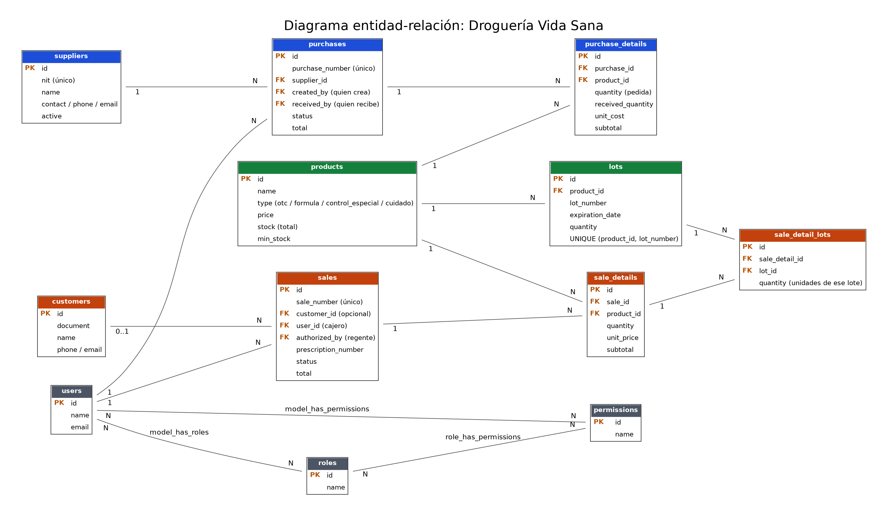

# Análisis de la Droguería Vida Sana

**Segundo parcial – Software de Gestión Empresarial – COTECNOVA 2026**

Integrantes: *[nombres]*

---

## 1. Flujo integrado

El flujo conecta compras, inventario por lote, ventas y control sanitario. Cada paso deja datos que el siguiente usa.

1. **Detección de la necesidad.** El dashboard muestra los productos con stock por debajo del mínimo (`stock <= min_stock`) y los lotes que vencen pronto. El administrador o el regente decide qué reabastecer.
2. **Orden de compra.** El administrador (permiso `crear-compras`) crea una orden al distribuidor, que debe estar activo, con los productos, las cantidades y el costo. Queda en estado `pending`, recibe el consecutivo OC-00001 y se guarda quién la creó (`created_by`). **El inventario no cambia.**
3. **Llegada de la mercancía.** El distribuidor entrega en una o varias entregas. El auxiliar de bodega descarga y el regente revisa. Quien registra la recepción (permiso `recibir-lotes`) indica, por cada línea, la cantidad recibida, el número de lote y la fecha de vencimiento que trae la caja.
4. **Recepción por lote.** `PurchaseService::receive`, dentro de `DB::transaction`, valida que no se reciba más de lo pedido, que el lote no llegue vencido y que quien recibe sea distinto de quien creó la orden. Luego crea el lote en `lots` (o suma al lote existente del mismo producto y número), aumenta `products.stock`, sube `received_quantity` y deja la orden en `partial` o `received`.
5. **Inventario.** Cada producto tiene un stock total y uno o varios lotes con su vencimiento. Un lote vencido permanece en la base de datos para su baja y auditoría, pero nunca se vende.
6. **Venta.** El cajero registra la venta (cliente opcional, productos y cantidades). Un Form Request valida los datos; si el producto es de fórmula exige el número de fórmula; si es de control especial, la venta queda en `pending_authorization` hasta que el regente la autorice (permiso `dispensar-control-especial`).
7. **Despacho FEFO.** `DispensingService::dispense`, dentro de `DB::transaction`, ignora los lotes vencidos, valida que alcance el stock no vencido, descuenta primero del lote que vence antes y descuenta el stock total. Devuelve de qué lotes salió cada unidad; la venta guarda eso en `sale_detail_lots`.
8. **Documento.** Se genera la factura PDF FV-00001 con el producto, la cantidad, el lote y el vencimiento de cada unidad despachada. Eso permite rastrear un lote si el laboratorio ordena retirarlo.
9. **Indicador.** El dashboard se actualiza (ventas del día, unidades por vencer, órdenes por recibir) y el ciclo vuelve al paso 1.

## 2. Reglas de negocio

| # | Regla | Módulo | Dónde se implementa |
|---|---|---|---|
| 1 | Nunca se vende un lote vencido | Ventas / Inventario | **Servicio** `DispensingService`: filtra `expiration_date >= hoy` |
| 2 | Se vende primero el lote que vence antes (FEFO) | Ventas / Inventario | **Servicio** `DispensingService`: `orderBy('expiration_date')` |
| 3 | Si no alcanza el stock no vencido, no se vende nada y no cambia ningún dato | Ventas | **Servicio** con `DB::transaction` y `ValidationException`, validando antes de descontar |
| 4 | El número de lote no se repite dentro de un producto | Inventario | **Base de datos** (índice único `product_id, lot_number`) y **Form Request** de recepción |
| 5 | No se recibe un lote que ya llega vencido | Compras | **Form Request** de recepción (`expiration_date` posterior a hoy) |
| 6 | No se recibe más de lo pedido en una línea | Compras | **Servicio** `PurchaseService::receive` |
| 7 | Quien crea la orden de compra no la puede recibir | Compras / Seguridad | **Middleware** de permisos (permisos separados) y **servicio** (`received_by` distinto de `created_by`) |
| 8 | Un medicamento de control especial solo se despacha con autorización del regente | Ventas / Seguridad | **Middleware** `permission:dispensar-control-especial` en la acción de autorizar y **servicio** que mantiene la venta en `pending_authorization` |
| 9 | Un medicamento con fórmula exige el número de fórmula médica | Ventas | **Form Request** (`required_if` según el tipo del producto) |
| 10 | Solo se anula una orden de compra pendiente | Compras | **Servicio** (`cancel`) |
| 11 | Al anular una venta las unidades vuelven a los mismos lotes de los que salieron | Ventas | **Servicio** con `DB::transaction`, usando `sale_detail_lots` |
| 12 | No se compra a un proveedor inactivo | Compras | **Form Request** (`exists` con `active = true`) |
| 13 | El cajero no ve costos ni compras | Seguridad | **Middleware** de permisos y **vista** (`@can('ver-costos')`) |
| 14 | No se elimina un producto que tiene lotes o ventas | Productos | **Base de datos** (`restrictOnDelete`) y **controlador** |

## 3. Estados

**Orden de compra**

| Estado | Significado | Efecto en el inventario |
|---|---|---|
| `pending` | Orden creada, aún no llega nada | Ninguno |
| `partial` | Llegó una parte de lo pedido | Suma solo lo recibido (lotes y stock total) |
| `received` | Llegó todo lo pedido | La suma completa ya está en inventario; la orden se cierra |
| `cancelled` | Anulada; solo posible desde `pending` | Ninguno (no había entrado nada) |

Transiciones: `pending` → `partial` → `received`; `pending` → `cancelled`.

**Venta**

| Estado | Significado | Efecto en el inventario |
|---|---|---|
| `pending_authorization` | Contiene control especial y espera al regente | Ninguno (no se descuenta nada) |
| `completed` | Venta confirmada | Se descuenta por FEFO y se crean los registros de `sale_detail_lots` |
| `rejected` | El regente no autorizó | Ninguno |
| `cancelled` | Venta anulada | Las unidades regresan a los lotes de origen |

Transiciones: `pending_authorization` → `completed` o `rejected`; `completed` → `cancelled`. Una venta sin control especial nace directamente en `completed`.

## 4. Indicadores (KPIs)

| KPI | Cómo se calcula | Decisión que permite al dueño |
|---|---|---|
| Unidades próximas a vencer en 30 días | `SUM(quantity)` de lotes con vencimiento entre hoy y hoy + 30 días | Hacer promociones o devolver al laboratorio antes de perder el producto |
| Valor del inventario vencido | `SUM(quantity × price)` de lotes con vencimiento anterior a hoy | Medir la pérdida y reclamar al proveedor |
| Productos bajo el stock mínimo | Productos con `stock <= min_stock` | Decidir qué ordenar y a quién |
| Órdenes de compra por recibir | Órdenes en `pending` o `partial` | Hacer seguimiento a los distribuidores que no han entregado |
| Ventas del día y del mes | Suma de `total` de ventas `completed` | Evaluar el ritmo comercial |
| Top 5 productos más vendidos | `SUM(quantity)` en `sale_details` agrupado por producto | Priorizar las compras de lo que más rota |
| Ventas de control especial pendientes de autorización | Conteo de ventas en `pending_authorization` | Garantizar que el regente atienda las autorizaciones sin demora |

---

## Modelo de datos

Entidades: `products`, `lots`, `suppliers`, `purchases`, `purchase_details`, `customers`, `sales`, `sale_details`, `sale_detail_lots` y las tablas de Spatie (`users`, `roles`, `permissions` y sus tablas intermedias).

Cardinalidades principales:

- `products` 1:N `lots`
- `suppliers` 1:N `purchases`; `purchases` 1:N `purchase_details`; `products` 1:N `purchase_details`
- `customers` 0..1:N `sales` (la venta de mostrador puede no tener cliente); `sales` 1:N `sale_details`; `products` 1:N `sale_details`
- `sale_details` 1:N `sale_detail_lots` y `lots` 1:N `sale_detail_lots` (relación N:M entre líneas de venta y lotes)
- `users` 1:N `purchases` (dos veces: `created_by` y `received_by`) y 1:N `sales`
- `users` N:M `roles`, `roles` N:M `permissions` y `users` N:M `permissions` (permisos directos)

### Diccionario de datos

**Tabla `lots`**

| Campo | Tipo | Descripción | Restricciones |
|---|---|---|---|
| id | bigint unsigned | Identificador del lote | PK, auto-incremental |
| product_id | bigint unsigned | Producto al que pertenece el lote | FK a `products.id`, no nulo, `restrictOnDelete` |
| lot_number | varchar(50) | Número de lote impreso por el laboratorio | No nulo; único junto con `product_id` |
| expiration_date | date | Fecha de vencimiento; define el orden FEFO | No nulo |
| quantity | int unsigned | Unidades que quedan disponibles en el lote | No nulo; baja con cada despacho |
| created_at, updated_at | timestamp | Control de registro | Nulos permitidos |

Índice único: (`product_id`, `lot_number`).

**Tabla `purchase_details`**

| Campo | Tipo | Descripción | Restricciones |
|---|---|---|---|
| id | bigint unsigned | Identificador de la línea | PK, auto-incremental |
| purchase_id | bigint unsigned | Orden de compra a la que pertenece | FK a `purchases.id`, no nulo, `cascade` |
| product_id | bigint unsigned | Medicamento o producto pedido | FK a `products.id`, no nulo, `restrict` |
| quantity | int | Unidades pedidas | No nulo; mayor que 0 |
| received_quantity | int | Unidades recibidas hasta el momento | No nulo; por defecto 0; nunca mayor que `quantity` (lo valida el servicio) |
| unit_cost | decimal(12,2) | Costo por unidad que cobra el distribuidor | No nulo; mayor o igual a 0 |
| subtotal | decimal(14,2) | `quantity × unit_cost` | No nulo |
| created_at, updated_at | timestamp | Control de registro | Nulos permitidos |

Esta tabla no guarda el lote: una misma línea puede llegar en varias entregas con lotes distintos, así que el lote se registra en `lots` al recibir.

**Tabla `sale_details`**

| Campo | Tipo | Descripción | Restricciones |
|---|---|---|---|
| id | bigint unsigned | Identificador de la línea | PK, auto-incremental |
| sale_id | bigint unsigned | Venta a la que pertenece | FK a `sales.id`, no nulo, `cascade` |
| product_id | bigint unsigned | Producto vendido | FK a `products.id`, no nulo, `restrict` |
| quantity | int | Unidades vendidas | No nulo; mayor que 0 |
| unit_price | decimal(12,2) | Precio por unidad al momento de la venta | No nulo |
| subtotal | decimal(14,2) | `quantity × unit_price` | No nulo |
| created_at, updated_at | timestamp | Control de registro | Nulos permitidos |

**Tabla `sale_detail_lots`** (trazabilidad)

| Campo | Tipo | Descripción | Restricciones |
|---|---|---|---|
| id | bigint unsigned | Identificador | PK, auto-incremental |
| sale_detail_id | bigint unsigned | Línea de venta | FK a `sale_details.id`, no nulo, `cascade` |
| lot_id | bigint unsigned | Lote del que salieron las unidades | FK a `lots.id`, no nulo, `restrict` |
| quantity | int | Unidades de esa línea que salieron de ese lote | No nulo; mayor que 0 |

Índice único: (`sale_detail_id`, `lot_id`).

### ¿En qué tabla se guarda de qué lote salió cada unidad vendida?

En **`sale_detail_lots`**, una tabla intermedia entre `sale_details` y `lots`. La justificación:

1. **Una línea de venta puede salir de varios lotes.** Con FEFO, una venta de 8 unidades puede tomar 5 del lote L2 y 3 del lote L3. Una columna `lot_id` en `sale_details` solo guardaría un lote, así que perdería información.
2. **Es una relación muchos a muchos.** Una línea toma de varios lotes y un lote abastece a muchas líneas; esa relación se resuelve con una tabla puente que además guarda la cantidad de cada aporte.
3. **Permite anular correctamente.** Al cancelar una venta se sabe exactamente a qué lote devolver cada unidad. Sin ese dato habría que adivinar.
4. **Permite el retiro sanitario.** Si el laboratorio retira el lote X, una consulta sobre `sale_detail_lots` dice a qué ventas y clientes se despachó. `lots.quantity` solo dice cuánto queda, no adónde fue lo demás.

---

## Matriz de seguridad

Roles: **admin** (dueño), **regente** (responsable técnico), **cajero** y **auxiliar-bodega**. ✔ permitido, ✘ sin acceso.

| Módulo | Acción (permiso) | admin | regente | cajero | auxiliar-bodega |
|---|---|:-:|:-:|:-:|:-:|
| Productos | Ver (`ver-productos`) | ✔ | ✔ | ✔ | ✔ |
| Productos | Crear y editar | ✔ | ✔ | ✘ | ✘ |
| Productos | Eliminar | ✔ | ✘ | ✘ | ✘ |
| Lotes | Ver (`ver-lotes`) | ✔ | ✔ | ✘ | ✔ |
| Lotes | **Recibir lotes** (`recibir-lotes`) | ✘ | ✔ | ✘ | ✔ |
| Proveedores | Ver | ✔ | ✔ | ✘ | ✘ |
| Proveedores | Crear, editar y eliminar | ✔ | ✘ | ✘ | ✘ |
| Compras | Ver | ✔ | ✔ | ✘ | ✔ |
| Compras | Crear y anular | ✔ | ✘ | ✘ | ✘ |
| Ventas | Ver | ✔ | ✔ | ✔ | ✘ |
| Ventas | Crear | ✔ | ✘ | ✔ | ✘ |
| Ventas | Anular | ✔ | ✔ | ✘ | ✘ |
| Ventas | **Dispensar control especial** (`dispensar-control-especial`) | ✘ | ✔ | ✘ | ✘ |
| Clientes | Ver | ✔ | ✔ | ✔ | ✘ |
| Clientes | Crear y editar | ✔ | ✘ | ✔ | ✘ |
| Clientes | Eliminar | ✔ | ✘ | ✘ | ✘ |
| Reportes | Ver dashboard (`ver-reportes`) | ✔ | ✔ | ✘ | ✘ |
| Reportes | Ver costos (`ver-costos`) | ✔ | ✘ | ✘ | ✘ |
| Configuración | Usuarios y roles | ✔ | ✘ | ✘ | ✘ |

Dos decisiones que no son obvias: el **admin no recibe lotes ni autoriza control especial**. Lo primero cumple la segregación de funciones; lo segundo porque la responsabilidad técnica sanitaria es del regente, no del dueño.

### Cómo la matriz cumple la segregación de funciones (quien compra no recibe)

1. **Permisos separados.** `crear-compras` solo lo tiene el admin y `recibir-lotes` solo el regente y el auxiliar. Ningún rol tiene los dos permisos.
2. **Regla en el servicio.** `PurchaseService::receive` compara `received_by` con `created_by` y rechaza la recepción si coinciden. Esto protege el caso en que a alguien se le asigne un segundo rol o un permiso directo que reúna ambas funciones.
3. **Trazabilidad.** La tabla `purchases` guarda `created_by` y `received_by`, así que una auditoría puede comprobar que nunca fueron la misma persona.

La misma lógica separa otras funciones: el cajero vende pero no autoriza control especial, el regente autoriza pero no gestiona compras, y el cajero no ve costos.

### El regente cubre la caja los sábados

**Decisión: asignarle un segundo rol (`cajero`) y no un permiso directo.**

- **Es una función recurrente de un puesto.** Atender la caja es todos los sábados y corresponde al trabajo de un cajero. Los roles representan puestos; los permisos directos son para excepciones puntuales (por ejemplo, cubrir un solo día o una necesidad que ningún rol cubre).
- **Mantiene el mínimo privilegio.** El rol `cajero` solo le da lo que necesita para vender (`crear-ventas`, `crear-clientes` y `editar-clientes`), sin costos ni compras.
- **No rompe la segregación.** `cajero` no incluye ni `crear-compras` ni `recibir-lotes`.
- **Es fácil de auditar.** Si mañana cambia el cajero de los sábados, se quita un rol y no una lista suelta de permisos.

Un permiso directo (`crear-ventas`) sería lo correcto si solo hubiera que cubrir un sábado puntual, y se debería revocar al terminar.

**¿Qué rol elegiría al iniciar sesión?** Los sábados, **`cajero`**; de lunes a viernes, **`regente`**. Iniciar con el rol que corresponde a la tarea de ese momento evita actuar con más autoridad de la necesaria y deja constancia clara de en qué calidad se hizo cada operación. Si un sábado entra una venta de control especial, esa venta queda en `pending_authorization` y el regente debe cambiar a su propio rol para autorizarla: el cambio es deliberado y queda registrado.
